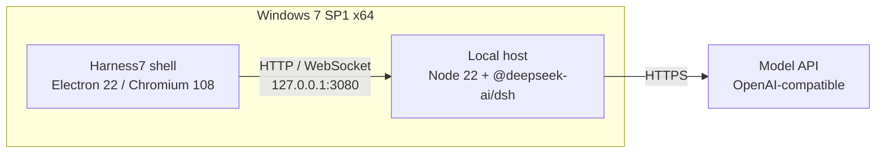

<div align="center">


# Harness7

**DeepSeek Harness for Windows 7**

[](https://github.com/MiG144/dsh-win7/actions/workflows/ci.yml)
[](https://github.com/MiG144/dsh-win7/releases)
[](LICENSE)
[](#install)

<sub>Unofficial project · <a href="README.md">简体中文</a></sub>

</div>

> Harness7 keeps DeepSeek Harness usable on Windows 7. It bundles an Electron 22 shell,
> a Node 22 runtime and the official Harness package into a single installer — double-click
> and go, no second machine required.


## Features

- **Self-contained** — the installer ships Node 22 and the Harness host; no server or VM needed
- **Native Win7** — Electron 22 / Chromium 108; not remote desktop, not a web wrapper
- **No source changes** — runs the official `@deepseek-ai/dsh` package unmodified
- **Process supervision** — starts the host, waits for the port, restarts on crash, cleans up on exit
- **Offline-friendly** — only the model API is required after installation; no CDN dependency
- **Desktop integration** — tray, single instance, window state, external links in the browser

## Quick start

### Installer

Download `Harness7-<version>-setup.exe` from [Releases](https://github.com/MiG144/dsh-win7/releases).
The binaries are unsigned; verify `SHA256SUMS.txt` after download.

On first launch, configure an OpenAI-compatible endpoint and key under **Settings → Models**.

### From source

```powershell
git clone https://github.com/MiG144/dsh-win7.git
cd dsh-win7\apps\shell
npm ci
npm run dist
```

Runtime preparation and offline packaging: [docs/BUILD.md](docs/BUILD.md).

## Architecture



The shell starts the host, waits until it is ready, then loads the UI. The host owns sessions,
model calls and tool execution.

## Status

| Phase | Scope | State |
| --- | --- | --- |
| Phase 0 | Node 22 + official host running on Win7 | ✅ verified |
| Phase 1 | Self-contained installer (shell + runtime + host) | ✅ released |
| Phase 2 | Terminal, Office and other capabilities | 📋 planned |

See [Releases](https://github.com/MiG144/dsh-win7/releases) for the latest build and
[docs/PLAN.md](docs/PLAN.md) for the full plan.

## Documentation

The docs are written in Chinese. Entry points:

| Document | Content |
| --- | --- |
| [docs/PLAN.md](docs/PLAN.md) | Phases, acceptance criteria, risks |
| [docs/PHASE0.md](docs/PHASE0.md) · [docs/PHASE1.md](docs/PHASE1.md) | Win7 verification records |
| [docs/FEASIBILITY.md](docs/FEASIBILITY.md) | Why this stack |
| [docs/ARCHITECTURE.md](docs/ARCHITECTURE.md) | Process model and auth |
| [docs/BUILD.md](docs/BUILD.md) | Packaging, CI, offline distribution |
| [docs/COMPATIBILITY.md](docs/COMPATIBILITY.md) | Patches and feature matrix |
| [docs/FAQ.md](docs/FAQ.md) | Install, networking, data locations |
| [docs/BACKLOG.md](docs/BACKLOG.md) | Planned work |

## Limitations

- **No terminal or Office skills yet** — scheduled for Phase 2
- **Chromium 108** — a few modern CSS features degrade gracefully
- **Windows 7 is out of support** — deploy on a controlled network

## Contributing

Issues and pull requests are welcome. Please read [CONTRIBUTING.md](CONTRIBUTING.md) and the
[Code of Conduct](CODE_OF_CONDUCT.md) first.

## License

[MIT](LICENSE). Naming and trademark notes are in [TRADEMARKS.md](TRADEMARKS.md);
third-party components are listed in [NOTICE](NOTICE).

## Acknowledgements

- [DeepSeek Harness](https://github.com/deepseek-ai/deepseek-harness) — what this project runs
- [Electron](https://www.electronjs.org/) 22 — the last major version available on Windows 7
- [DeftKing/nodejs-win7](https://github.com/DeftKing/nodejs-win7) — Node 22 build for Windows 7

---

A personal project, largely AI-assisted, provided as-is without response-time or maintenance promises.
