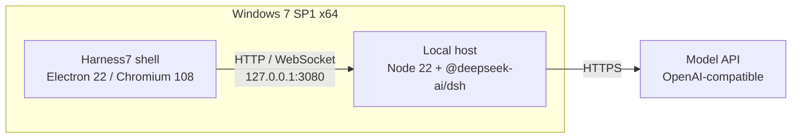

<div align="center">


# Harness7

**DeepSeek Harness for Windows 7**

[](https://github.com/MiG144/dsh-win7/actions/workflows/ci.yml)
[](https://github.com/MiG144/dsh-win7/releases)
[](LICENSE)
[](#install)

<sub>Unofficial project · <a href="README.md">简体中文</a></sub>

</div>

> The official DeepSeek Harness build supports Windows 10 and later only. Harness7 provides a
> Windows 7 runtime for it: the installer bundles the Node runtime and the official components,
> so no additional setup is required.


## Features

- **Self-contained** — the installer ships Node 22 and the Harness host; no server or VM needed
- **Native Win7** — Electron 22 / Chromium 108; not remote desktop or a browser wrapper
- **No source changes** — runs the official `@deepseek-ai/dsh` package unmodified
- **Process supervision** — starts the host, waits for the port, restarts on crash, cleans up on exit
- **Offline-friendly** — only the model API is required after installation; no CDN dependency
- **Desktop integration** — tray, single instance, window state, external links in the browser

## Quick start

### Installer

Download `Harness7-<version>-setup.exe` from [Releases](https://github.com/MiG144/dsh-win7/releases).
The binaries are unsigned; verify `SHA256SUMS.txt` after download.

On first launch, configure an OpenAI-compatible endpoint and key under **Settings → Models**.

### From source

```powershell
git clone https://github.com/MiG144/dsh-win7.git
cd dsh-win7\apps\shell
npm ci
npm run dist
```

Runtime preparation and offline packaging: [docs/BUILD.md](docs/BUILD.md).

## Architecture



The shell starts the host, waits until it is ready, then loads the UI. The host owns sessions,
model calls and tool execution.

## Capabilities

**Works today**

| Capability | Notes |
| --- | --- |
| Chat | Text conversation, streaming output, multiple sessions |
| Workspace | File read/write, syntax highlighting, Markdown preview |
| Models | Any OpenAI-compatible API, intranet or public |
| Desktop | Tray, single instance, window state, reconnect |
| Image attachments | Paste and attach images (`sharp` verified on Win7) |
| Update check | Automatic on launch; manual via Help → Check for updates |
| Launch at login | Toggle in the app menu (Windows login item) |

**Not supported yet**

| Capability | Why |
| --- | --- |
| Terminal | `node-pty` cannot launch ConPTY on Windows 7 |
| Voice input | The Windows APIs used by `sherpa-onnx` are missing on Windows 7 |
| Office skills | Depend on Python 3.12, which cannot run on Windows 7 |
| Auto-update, code signing | Requires a certificate and a stable distribution channel |

> Windows 7 is out of support; deploy on a controlled network.

## Documentation

The docs are written in Chinese. Entry points:

| Document | Content |
| --- | --- |
| [docs/VERIFICATION.md](docs/VERIFICATION.md) | Test results on a real Windows 7 machine |
| [docs/ARCHITECTURE.md](docs/ARCHITECTURE.md) | Process model and auth |
| [docs/BUILD.md](docs/BUILD.md) | Packaging, CI, offline distribution |
| [docs/COMPATIBILITY.md](docs/COMPATIBILITY.md) | Patches and feature matrix |
| [docs/FAQ.md](docs/FAQ.md) | Install, networking, data locations |

## Contributing

Issues and pull requests are welcome. Please read [CONTRIBUTING.md](CONTRIBUTING.md) first.

## License

[MIT](LICENSE). Naming and trademark notes are in [TRADEMARKS.md](TRADEMARKS.md);
third-party components are listed in [NOTICE](NOTICE).

## Acknowledgements

- [DeepSeek Harness](https://github.com/deepseek-ai/deepseek-harness) — what this project runs
- [Electron](https://www.electronjs.org/) 22 — the last major version available on Windows 7
- [DeftKing/nodejs-win7](https://github.com/DeftKing/nodejs-win7) — Node 22 build for Windows 7

---

A personal project, largely AI-assisted, provided as-is without response-time or maintenance promises.
