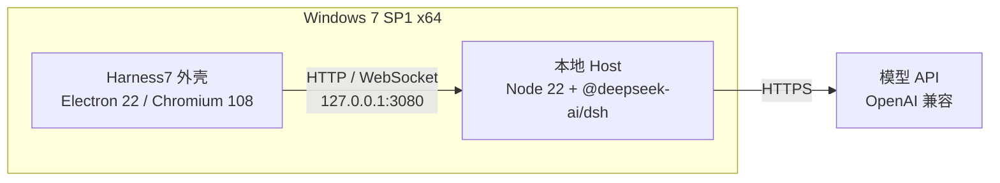

<div align="center">


# Harness7

**在 Windows 7 上运行 DeepSeek Harness**

[](https://github.com/MiG144/dsh-win7/actions/workflows/ci.yml)
[](https://github.com/MiG144/dsh-win7/releases)
[](LICENSE)
[](#安装)

<sub>非官方项目 · <a href="README.en.md">English</a></sub>

</div>

> Harness7 让已经停止支持的 Windows 7 仍然可以使用 DeepSeek Harness。
> 它把 Electron 22 外壳、Node 22 运行时和官方 Harness 包打成一个安装包，双击即用，不需要第二台机器。


## 特性

- **单机自包含** —— 安装包内置 Node 22 与 Harness Host，不需要额外服务器或虚拟机
- **原生 Win7** —— Electron 22 / Chromium 108，不是远程桌面，也不是网页套壳
- **零源码改动** —— 运行官方 `@deepseek-ai/dsh` 包，跟随上游升级，不打补丁
- **进程自管理** —— 启动 Host、等待端口、崩溃重启、退出回收，用户只面对一个窗口
- **离线可用** —— 安装后只需能访问模型 API，不依赖公网 CDN
- **桌面体验** —— 托盘常驻、单实例、窗口位置记忆、外链走系统浏览器

## 快速开始

### 安装包

从 [Releases](https://github.com/MiG144/dsh-win7/releases) 下载 `Harness7-<version>-setup.exe` 安装。
安装包未签名，SmartScreen 会提示；请核对 `SHA256SUMS.txt`。

首次启动后，在 Harness 的「设置 → 模型」里填写 OpenAI 兼容的 API 地址与密钥。

### 从源码

```powershell
git clone https://github.com/MiG144/dsh-win7.git
cd dsh-win7\apps\shell
npm ci
npm run dist
```

运行时准备与离线打包见 [构建文档](docs/BUILD.md)。

## 架构



外壳启动 Host、等待就绪后加载界面；Host 负责会话、模型调用与工具执行。

## 状态

| 阶段 | 内容 | 状态 |
| --- | --- | --- |
| Phase 0 | Node 22 + 官方 Host 在 Win7 本机运行 | ✅ 已验证 |
| Phase 1 | 自包含安装包（外壳 + 运行时 + Host） | ✅ 已发布 |
| Phase 2 | 终端、Office 等能力迁移 | 📋 计划中 |

最新版本见 [Releases](https://github.com/MiG144/dsh-win7/releases)，完整计划见 [项目计划](docs/PLAN.md)。

## 文档

| 文档 | 内容 |
| --- | --- |
| [项目计划](docs/PLAN.md) | 阶段划分、验收标准、风险 |
| [Phase 0](docs/PHASE0.md) · [Phase 1](docs/PHASE1.md) | Win7 实机验证记录 |
| [可行性报告](docs/FEASIBILITY.md) | 技术选型论证 |
| [架构](docs/ARCHITECTURE.md) | 进程模型、鉴权、目录布局 |
| [构建](docs/BUILD.md) | 打包、CI、离线分发 |
| [兼容性](docs/COMPATIBILITY.md) | 系统补丁、功能矩阵 |
| [常见问题](docs/FAQ.md) | 安装、网络、数据位置 |
| [待办](docs/BACKLOG.md) | 计划中的工作 |

## 已知限制

- **终端与 Office 技能**尚未支持，计划在 Phase 2 迁移
- **Chromium 108**：少量新 CSS 特性降级，不影响功能
- **Windows 7 已停止安全更新**：建议部署在受控网络

## 参与

欢迎 Issue 与 PR。提交前请阅读 [贡献指南](CONTRIBUTING.md) 与 [行为准则](CODE_OF_CONDUCT.md)。

## 许可

[MIT](LICENSE)。名称与商标说明见 [TRADEMARKS.md](TRADEMARKS.md)，第三方组件见 [NOTICE](NOTICE)。

## 致谢

- [DeepSeek Harness](https://github.com/deepseek-ai/deepseek-harness) —— 本项目的运行对象
- [Electron](https://www.electronjs.org/) 22 —— Win7 上可用的最后一个大版本
- [DeftKing/nodejs-win7](https://github.com/DeftKing/nodejs-win7) —— Node 22 的 Win7 构建

---

个人项目，主要由 AI 辅助开发，按现状提供，不承诺响应时间或长期维护。
