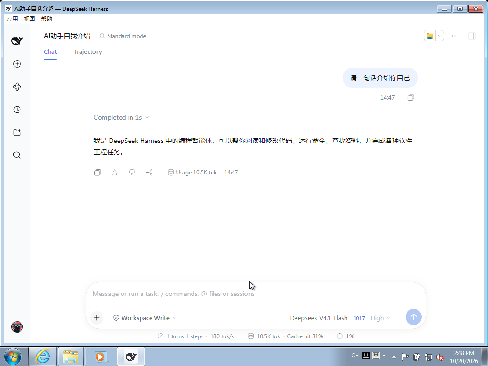

# 验证记录

> 环境：VirtualBox 7.2.20 虚拟机；Windows 7 SP1 x64（英文版，2018-08 刷新 ISO）；
> 4 GB 内存 / 2 核 / 1024×768；未安装 Guest Additions，软件渲染。

## 结果

| 项目 | 结果 | 说明 |
| --- | --- | --- |
| 外壳启动 | ✅ | Electron 22.3.27，无缺失 DLL |
| 界面渲染 | ✅ | 官方 Web UI 完整加载，中文显示正常 |
| 首次鉴权 | ✅ | `?token=` 换取签名 cookie |
| 免 token 重启 | ✅ | cookie 有效期内直接进入 |
| 对话与流式输出 | ✅ | 中文输入法下正常 |
| 托盘 | ✅ | 关窗进托盘，单击唤回 |
| 断连恢复 | ✅ | Host 停止后显示重连，恢复后自动接上 |
| 单机自包含安装 | ✅ | 安装包内置运行时与 Host，启动时自动拉起 |
| 控制台错误 | 0 | — |

## 不可用或未验证

- **终端、Office 技能**：依赖 Win10 的 ConPTY 与 Python 3.12，当前不可用（见 [兼容性](COMPATIBILITY.md)）
- **浏览器直连**：该前端无法在 IE11 中运行，必须使用 Electron 外壳
- **更高分辨率**：未安装 Guest Additions，测试分辨率为 1024×768
- **长时间稳定性**：未做持续压测

## 复现

构建与运行见 [构建](BUILD.md)；系统补丁与依赖见 [兼容性](COMPATIBILITY.md)。
